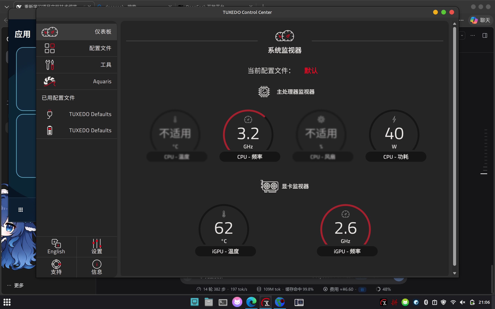
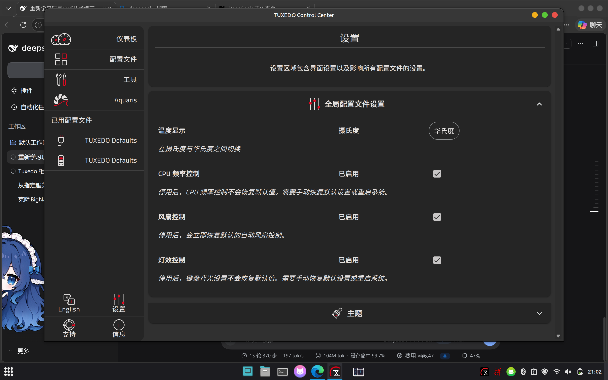
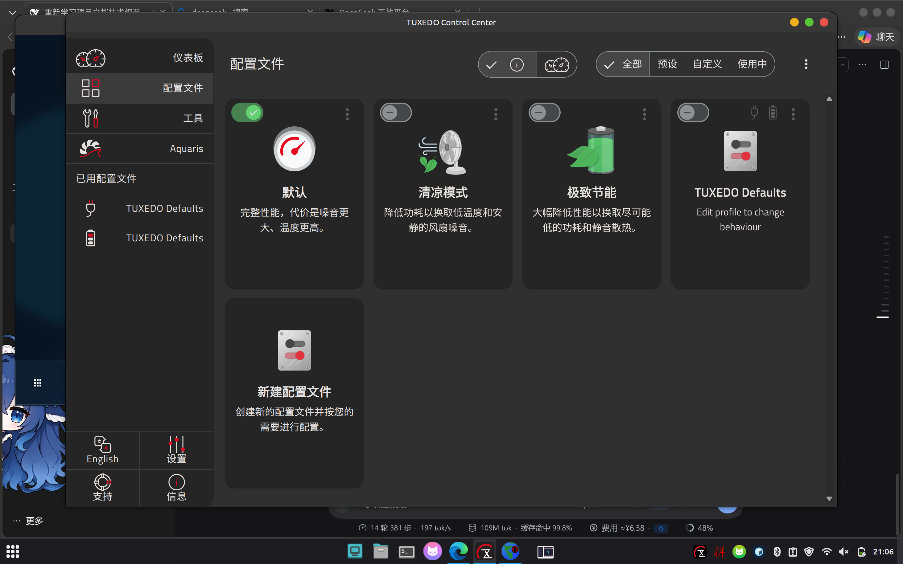
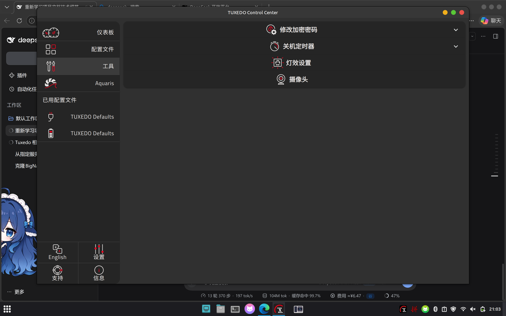

# TUXEDO Control Center 简体中文语言包（非官方）

给 [TUXEDO Control Center](https://www.tuxedocomputers.com/en/TUXEDO-Control-Center-TCC.tuxedo)
（TCC）补上简体中文界面。官方目前只提供**德语 / 英语**，没有中文版；这个项目基于官方
GPL-3.0 源码做了完整的 zh-CN 界面（437 条文案），打包成可以直接安装的 deb / tar.gz。

> 非官方项目，与 TUXEDO Computers GmbH 无关。所有界面代码版权归 TUXEDO Computers GmbH，
> 本项目只提供翻译和安装脚本，同样以 GPL-3.0 发布。



## 特性

- 仪表板 / 配置文件 / 工具 / Aquaris / Tomte / 摄像头 / 设置 / 支持 / 信息，全部中文
- 左下角语言按钮 **English ⇄ 简体中文** 一键切换（英文、德文界面里也加了“简体中文”选项）
- 系统托盘里的配置文件名、通知等也会跟着变中文（托盘右键菜单的固定项是上游硬编码英文，无法翻译）
- 不修改官方 `app.asar`：把它解开成 `resources/app/` 目录再打补丁，原文件改名备份，卸载即还原
- 支持 `apt remove` 自动还原；不需要联网，安装只要几秒钟

## 截图

| 设置 | 配置文件 | 工具 |
| --- | --- | --- |
|  |  |  |

## 支持版本

- 目标版本：**TCC 3.1.x**（在 3.1.2 上实测；界面用 3.1.1 源码构建）
- 系统：Debian / Ubuntu / Linux Mint 等使用 dpkg 的发行版；tar.gz 方式适用于任何发行版
- 其他版本可以用 `--force` 尝试，或按 [重新构建](#重新构建中文界面) 用对应 tag 重新编译

## 安装

### 方式一：deb 包（推荐）

```bash
sudo apt install ./tcc-zh-cn_3.1.2-zh1_all.deb
# 或者
sudo dpkg -i tcc-zh-cn_3.1.2-zh1_all.deb
```

装完**退出并重新打开 TCC** 即可看到中文。

### 方式二：tar.gz

```bash
tar xzf tcc-zh-cn-3.1.2-zh1.tar.gz
cd tcc-zh-cn-3.1.2-zh1
sudo bash install.sh
```

`install.sh` 会自己重启 TCC（如果拿得到图形环境变量），否则按提示手动重开。

### 方式三：直接克隆仓库

```bash
git clone <你的仓库地址> tcc-zh-cn
cd tcc-zh-cn
sudo bash install.sh
```

## 卸载

```bash
sudo apt remove tcc-zh-cn        # deb 安装的
# 或
sudo bash uninstall.sh           # tar.gz / 仓库安装的
```

卸载会删除 `resources/app/` 并把备份的 `app.asar` 改回来，同时把界面语言切回英文。

## 升级 TCC 之后

`apt upgrade` 升级 `tuxedo-control-center` 时，官方包会写回一个新的 `app.asar`，
Electron 会优先加载它 —— 中文界面“消失”，变回英文，但不会损坏任何东西。

重新安装一次本语言包即可（`sudo apt install --reinstall ./tcc-zh-cn_*.deb`，
或再跑一遍 `install.sh`）。脚本会先恢复旧备份、再基于新版 asar 重新打补丁。

## 原理

Electron 查找应用的顺序是 `resources/app.asar` → `resources/app` 目录。所以：

1. 用纯 Python 写的 `lib/asar_extract.py` 把官方 `app.asar` 解开（不依赖 node/npm）
2. 塞入 `payload/zh-CN/`（Angular 本地化构建产物），并把 `lang.zh-CN.xlf` 放进
   `browser/en-US/assets/locale/`（主进程托盘文案用它）
3. 在 en / de / en-US 三个界面的 `languagesMenuArray` 里追加中文项，
   后台 `availableLanguages` 里加入 `zh-CN`
4. 把 `app.asar` 改名为 `app.asar.tcczh-backup`，让 `resources/app/` 生效

全程只用 Python 标准库 + bash，不联网、不编译。

## 已知限制

- 托盘右键菜单的固定项（Profiles / Fn-Lock / Graphics / Exit…）是上游源码里硬编码的英文，没走 i18n
- 配置文件页里**自定义**配置档的名称和描述来自 `/etc/tcc/profiles` 用户数据
  （如 `TUXEDO Defaults` / `Edit profile to change behaviour`），不属于界面文案；
  官方德语版同样如此
- 界面构建自 TCC 3.1.1 源码，后台是 3.1.2，实测功能正常，但大版本升级后可能不匹配

## 目录结构

```
.
├── install.sh              # 安装（sudo）
├── uninstall.sh            # 卸载（sudo）
├── lib/
│   ├── asar_extract.py     # 纯标准库的 app.asar 解包器
│   └── patch_bundles.py    # 写入中文界面、修改语言菜单
├── payload/
│   ├── zh-CN/              # Angular 中文构建产物（约 5 MB）
│   └── lang.zh-CN.xlf      # 托盘 / 主进程用的翻译
├── i18n/lang.zh-CN.xlf     # 翻译源文件（提交给上游也用这个）
├── tools/
│   ├── build-zh-bundle.sh  # 从上游源码重建 payload
│   ├── make-dist.sh        # 打 tar.gz / deb
│   └── test-smoke.sh       # 假根目录冒烟测试
├── docs/screenshots/
├── Makefile
└── .github/workflows/
```

## 重新构建中文界面

需要 node ≥ 20、npm 和网络：

```bash
./tools/build-zh-bundle.sh                 # 默认克隆上游 v3.1.1 并构建
./tools/build-zh-bundle.sh --tag v3.1.2    # 指定版本
./tools/build-zh-bundle.sh --src-dir ./src # 复用已 npm ci 的源码目录
```

构建会做四件事：放入 `lang.zh-CN.xlf`、在 `angular.json` 注册 `zh-CN`、在语言菜单加一项、
注册 Angular 的 zh-Hans locale 数据（`DecimalPipe` 需要），然后
`ng build --configuration production`。

## 更新翻译

1. 改 `i18n/lang.zh-CN.xlf`（XLIFF 1.2，437 条）
2. `./tools/build-zh-bundle.sh` 重新构建
3. `make test && make dist`

想贡献给上游：把 `lang.zh-CN.xlf` 放进 `src/ng-app/assets/locale/`，在 `angular.json` 的
`i18n.locales` 里加 `"zh-CN"`，再在 `languagesMenuArray` 里加一项，发 PR 即可。

## 发布

```bash
make dist      # 生成 dist/*.tar.gz 和 dist/*.deb
git tag v3.1.2-zh1 && git push --tags   # 触发 Actions 自动创建 Release
```

`.github/workflows/release.yml` 会在打 tag 时自动打包并附到 GitHub Release；
也可以手动跑 `workflow_dispatch`。

## English

Unofficial Simplified Chinese localization for TUXEDO Control Center 3.1.x.
`sudo apt install ./tcc-zh-cn_*.deb` (or `sudo bash install.sh` from the tarball),
restart TCC, and the UI becomes Chinese. Uninstall with `apt remove tcc-zh-cn`
or `uninstall.sh`. The original `app.asar` is never modified — it is renamed to
`app.asar.tcczh-backup` and restored on removal.

## License

GPL-3.0. UI code © TUXEDO Computers GmbH; translation and installer scripts are
released under the same license. Not affiliated with TUXEDO Computers GmbH.
